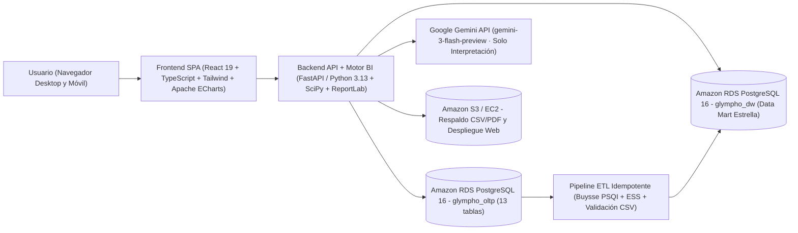
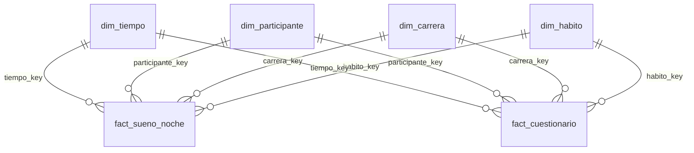
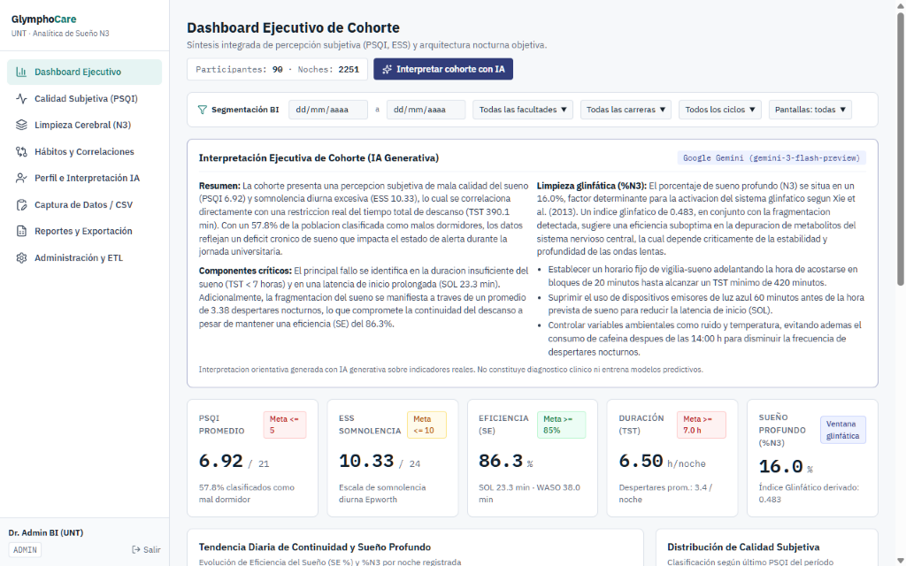
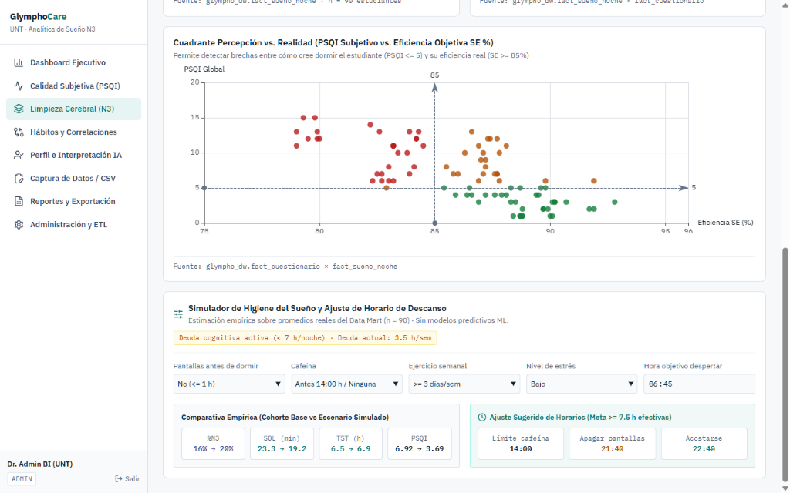
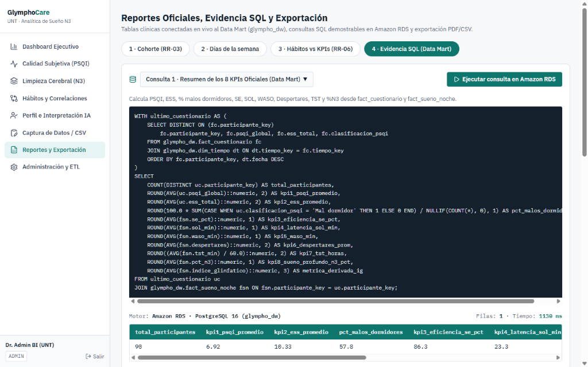

# GlymphoCare · Plataforma Analítica de Calidad del Sueño y Limpieza Cerebral (%N3)

**Universidad Nacional de Trujillo (UNT)** · Facultad de Ingeniería · Escuela Profesional de Ingeniería de Sistemas  
**Curso:** Inteligencia de Negocios (Unidad III — Proyecto Final, Grupo G5) · **Docente:** Dr. Ricardo Darío Mendoza Rivera

> **Propósito:** Integrar la percepción subjetiva del sueño (**PSQI**, **ESS** y hábitos de higiene) con métricas fisiológicas objetivas nocturnas (**SE**, **SOL**, **WASO**, **TST**, **Despertares** y **%N3**) en un **Data Mart en esquema estrella** sobre **Amazon RDS (PostgreSQL 16)**, destacando el sueño profundo de ondas lentas (**NREM N3**) como indicador de oportunidad de limpieza cerebral glinfática (*Xie et al., 2013, Science*).

---

## Arquitectura General y Despliegue en AWS



- **Sin herramientas BI propietarias:** Visualización 100% propia con **Apache ECharts** (evitando Power BI, QlikView y Tableau).
- **IA estrictamente interpretativa (`RF-10`):** No entrena modelos predictivos ni realiza diagnóstico clínico (`RNF-07`).

---

## Modelo Dimensional (Data Mart `glympho_dw`)



---

## Vistas Principales de la Plataforma

### Dashboard Ejecutivo e Interpretación de Cohorte con Gemini


### Limpieza Cerebral (%N3), Índice Glinfático y Simulador de Horarios


### Evidencia SQL en Vivo contra Amazon RDS (Data Mart)


---

## Ficha de los 8 KPIs Oficiales

| ID | Indicador | Fórmula / Regla | Umbral de Referencia |
| :--- | :--- | :--- | :--- |
| **RI-01** | **PSQI Global** | Suma de 7 componentes `C1..C7` (Buysse et al., 1989) | `> 5` = Mala calidad |
| **RI-03** | **ESS Epworth** | Suma de 8 situaciones diurnas (`0–3` c/u) | `> 10` = Somnolencia excesiva |
| **RI-04** | **Eficiencia del Sueño (SE)** | `(TST / TIB) × 100` | `>= 85%` |
| **RI-05** | **Latencia de Inicio (SOL)** | Minutos hasta el primer registro de sueño | `<= 20 min` (`> 30 min` alterado) |
| **RI-06** | **WASO** | `TIB − SOL − TST` | `<= 40 min` |
| **RI-07** | **TST** | `N1 + N2 + N3 + REM` | `>= 7 h` (`420 min`) |
| **RI-08** | **Número de Despertares** | Conteo de despertares por noche | Menor es mejor |
| **RI-09** | **Sueño Profundo (%N3)** | `(Min N3 / TST) × 100` | Seguimiento propio (`>= 15%` ref.) |

---

## Inicio Rápido (1 Clic en Windows)

1. Copia `.env.example` a `.env` (apuntando a Docker PostgreSQL local o a tu endpoint de **Amazon RDS**).
2. Ejecuta **`INICIAR_GLYMPHOCARE.bat`** (levanta FastAPI `:8000`, Vite `:5173` y abre el navegador).
3. Accede con cualquiera de los **4 roles de demostración** (contraseña: `Glympho2026!`):

| Rol | Correo | Capacidades |
| :--- | :--- | :--- |
| **Admin BI** | `admin@glymphocare.edu.pe` | Reglas/umbrales configurables, gestión de usuarios, ETL manual y clave Gemini |
| **Analista** | `analista@glymphocare.edu.pe` | Dashboards BI, correlaciones, simulador, reportes PDF/CSV, Evidencia SQL e IA |
| **Investigador** | `investigador@glymphocare.edu.pe` | Captura multi-paso PSQI/ESS, carga CSV wearable y seguimiento individual |
| **Participante** | `estudiante@glymphocare.edu.pe` | Registro de evaluaciones propias, subida CSV y lectura de recomendaciones |

---

## Estructura del Repositorio

```text
glymphocare/
├── database/              # DDLs OLTP (13 tablas), Data Mart Estrella, reglas y consultas SQL
├── etl/                   # Calculo oficial Buysse PSQI/ESS, validadores CSV y ETL idempotente
├── backend/               # FastAPI, estadistica SciPy, motor de reglas, PDF ReportLab y Gemini
├── frontend/              # React 19 + TypeScript + Tailwind CSS + Apache ECharts (responsive)
├── deploy/aws/            # Guia AWS Free Tier desde cero, migrate_to_rds.ps1, Docker + Nginx
├── sample_csvs/           # 3 archivos CSV de wearables listos para demostracion en vivo
├── docs/screenshots/      # Capturas reales de los 12 estados/pantallas del sistema
├── scripts/               # Generador automatizado de entregables oficiales UNIDAD3 (.docx)
└── tests/                 # Suite pytest (11 tests unitarios y de integracion E2E)
```

---

## Integrantes — Grupo G5 (UNT · Ingeniería de Sistemas, 2026)

- Cuba Moya, Diego Joel
- Herrera Rodríguez, Anghela Tatiana
- Polonio Ramos, Franco Imanol
- Rivas Calderón, Zaleth Valentina
- Robles Romero, Ronaldo Carlos
- Villanueva Rosales, Estefany Lucía
